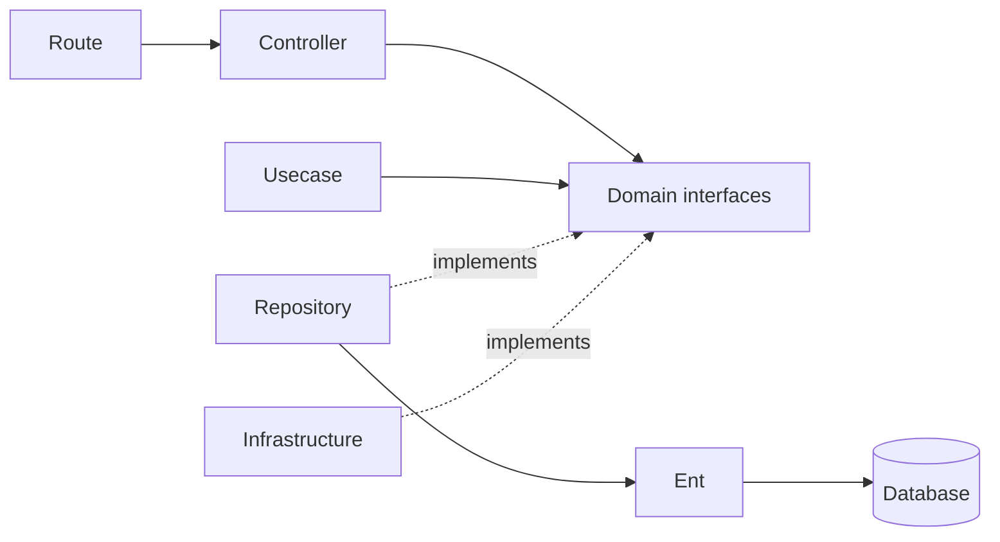
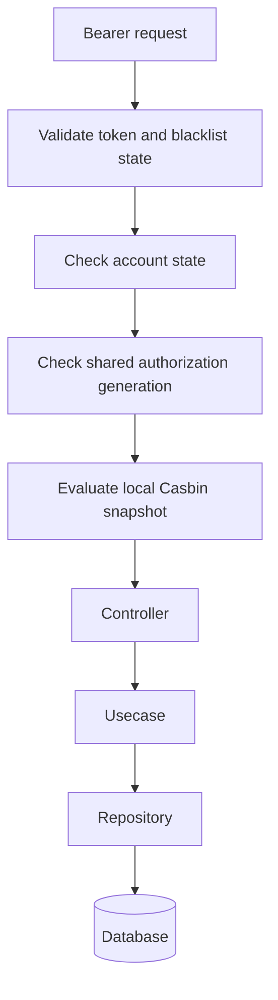

# Architecture Overview

This overview explains where code lives and how requests, sessions and authorization fit together. For implementation rules, use the [development skill](../../.agents/skills/shadmin-dev/SKILL.md) and its backend/frontend references.

## Boundaries and wiring

The backend uses Gin for HTTP, Ent for persistence and Casbin for authorization. Domain contracts keep frameworks and infrastructure outside business logic.



Arrows show the main code dependencies. Controllers invoke usecases through domain interfaces; usecases invoke repositories the same way. `bootstrap` injects the implementations. The runtime request flow is shown below.

| Location                                                                | Responsibility                                                       |
| ----------------------------------------------------------------------- | -------------------------------------------------------------------- |
| [domain/](../../domain/)                                                | Entities, DTOs, interfaces, errors, request and response contracts   |
| [usecase/](../../usecase/)                                              | Business rules, validation and timeouts                              |
| [repository/](../../repository/)                                        | Data access and domain/Ent conversion                                |
| [ent/schema/](../../ent/schema/)                                        | Database models; the rest of Ent is generated                        |
| [api/controller/](../../api/controller/)                                | HTTP parsing, usecase calls and error/status mapping                 |
| [api/route/](../../api/route/) and [middleware/](../../api/middleware/) | Route registration and independent access gates                      |
| [bootstrap/usecases.go](../../bootstrap/usecases.go)                    | Repository → usecase wiring                                          |
| [api/route/factory.go](../../api/route/factory.go)                      | Usecase → controller wiring                                          |
| [internal/](../../internal/)                                            | Token, authorization, cache and other infrastructure implementations |

Manual constructor injection connects these layers. Usecases depend on interfaces declared in `domain/`; `bootstrap` chooses and injects implementations.

## Request lifecycle

A system request such as `GET /api/v1/system/user` passes through independent gates before reaching business logic:



The `/system` parent group mounts authorization once. Basic authenticated endpoints such as `/profile` and `/resources` sit outside that group; public routes are registered separately. See [protected.go](../../api/route/protected.go) and [public.go](../../api/route/public.go).

Controllers return the shared [response and pagination types](../../domain/response.go). [Controller error rules](../../api/controller/errors.go) map known errors to HTTP statuses and keep unexpected internal errors out of client responses.

## Authorization and menus

Ent user/role/menu/API resource relationships are authoritative. Each process builds a local Casbin snapshot from them:

1. Startup scans Gin routes into API resources with stable `METHOD:/path` IDs.
2. Menus and buttons bind those resources; roles receive menus and users receive roles.
3. Authorization changes commit with an increment of the shared generation in the same transaction.
4. Each system request reads that generation and rebuilds its snapshot if needed before evaluating access. Generation read or rebuild failures return HTTP 503.

Local commit triggers and background polling warm and recover snapshots. Polling does not determine revocation latency; Redis does not distribute Casbin snapshots. Multi-instance requirements are covered in the [deployment guide](deployment.en.md#multiple-instances).

The frontend fetches menus and permission strings from `/api/v1/resources`. The sidebar renders that data, route guards check menu access, and `usePermission()` controls action visibility. API authorization remains enforced by the backend.

## Frontend and sessions

React uses TanStack Router for file routes, TanStack Query for server state, Axios for HTTP, and Zustand for authentication state. React Hook Form and Zod handle forms.

```text
routes/ → features/ → query hooks → services/ → apiClient → API
                           ↕
                    stores/auth-store
```

Types live in `types/`, API wrappers in `services/`, and pages, forms, tables and dialogs in `features/`. See the [user feature](../../frontend/src/features/system/users/) for a paginated example.

Password login returns an access/refresh token pair. `auth.startSession()` starts the session; token storage currently uses localStorage through [token-storage.ts](../../frontend/src/lib/token-storage.ts). The client sends access tokens as Bearer headers, fetches `/profile` and loads `/resources` before rendering authorized pages.

`auth.reset()` and new sign-ins advance a session revision, cancel obsolete requests and clear identity, Query and menu caches. Refresh updates the tokens within the current session. Refresh requests are serialized across same-origin tabs using Web Locks; browsers without that API require a new sign-in. Stale responses cannot restore an old account, and failed menu loads block navigation with a retry action.

## Infrastructure and startup

Database, storage and cache choices are configured in [.env.example](../../.env.example):

- Ent supports SQLite, PostgreSQL and MySQL.
- File storage uses `domain.FileRepository` for local disk and an AWS SDK for Go v2 adapter shared by AWS S3 and MinIO.
- Cache implementations use memory or Redis behind the cache contract.

See the [deployment guide](deployment.en.md) for configuration, migrations and persistence.

[cmd.Run](../../cmd/main.go) loads the application, registers routes, scans API resources, seeds the administrator and menus, builds the first authorization snapshot, and then starts serving. Startup failures return an error and close initialized resources; SIGINT/SIGTERM trigger graceful shutdown.

In production, `frontend/dist/` is embedded in the Go binary via [frontend.go](../../frontend/frontend.go). During development, Vite serves the frontend and proxies API calls to Go. Build/run instructions live in the [README](../../README.md#-get-running); the [development skill](../../.agents/skills/shadmin-dev/SKILL.md) covers adding a module.
