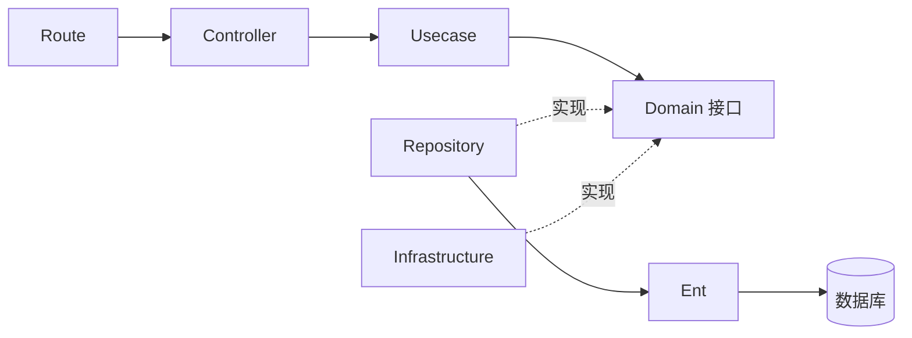
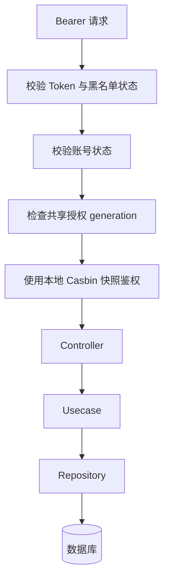

# 架构概览

本文解释代码位置，以及请求、会话和授权之间的关系。具体实现规则见[开发技能](../../.agents/skills/shadmin-dev/SKILL.md)及其前后端参考规范。

## 边界与装配

后端使用 Gin 处理 HTTP、Ent 访问数据库、Casbin 执行授权。领域契约将框架和基础设施隔离在业务逻辑之外。



箭头表示依赖关系。运行时，用例通过领域接口调用注入的实现。

| 位置                                                                   | 职责                                    |
| ---------------------------------------------------------------------- | --------------------------------------- |
| [domain/](../../domain/)                                               | 实体、DTO、接口、错误、请求与响应契约   |
| [usecase/](../../usecase/)                                             | 业务规则、校验和超时                    |
| [repository/](../../repository/)                                       | 数据访问和领域实体与 Ent 的转换         |
| [ent/schema/](../../ent/schema/)                                       | 数据库模型；其余 Ent 代码由工具生成     |
| [api/controller/](../../api/controller/)                               | HTTP 解析、用例调用和错误到状态码的映射 |
| [api/route/](../../api/route/) 与 [middleware/](../../api/middleware/) | 路由注册和独立的访问控制关卡            |
| [bootstrap/usecases.go](../../bootstrap/usecases.go)                   | 仓储 → 用例装配                         |
| [api/route/factory.go](../../api/route/factory.go)                     | 用例 → 控制器装配                       |
| [internal/](../../internal/)                                           | Token、授权、缓存等基础设施实现         |

各层通过构造函数手动注入。用例依赖 `domain/` 中的接口，`bootstrap` 选择并注入实现。

## 请求链路

`GET /api/v1/system/user` 等系统请求在进入业务逻辑前，依次经过独立的关卡：



`/system` 父组统一挂载授权中间件。`/profile`、`/resources` 等基础认证接口位于该组之外；公开接口单独注册。见 [protected.go](../../api/route/protected.go) 和 [public.go](../../api/route/public.go)。

控制器返回统一的[响应与分页类型](../../domain/response.go)。[控制器错误映射](../../api/controller/errors.go)将已知错误转换为 HTTP 状态码，并阻止意外内部错误泄露到客户端。

## 授权与菜单

Ent 中的用户、角色、菜单和 API 资源关系是授权事实的来源。各进程据此构建本地 Casbin 快照：

1. 启动时扫描 Gin 路由，生成 ID 为 `METHOD:/path` 的 API 资源。
2. 菜单和按钮绑定 API 资源，角色获得菜单，用户获得角色。
3. 授权变更与共享 generation 的递增在同一事务内提交。
4. 每个系统请求先读取 generation，必要时重建快照再鉴权。读取或重建失败返回 HTTP 503。

本地提交触发器与后台轮询负责预热和恢复快照。轮询间隔不决定撤权延迟；Redis 不分发 Casbin 快照。多实例要求见[部署指南](deployment.zh.md#多实例)。

前端从 `/api/v1/resources` 获取菜单和权限标识。侧边栏渲染后端数据，路由守卫检查菜单访问权，`usePermission()` 控制操作按钮显隐。API 权限由后端强制执行。

## 前端与会话

React 使用 TanStack Router 组织文件路由、TanStack Query 管理服务端状态、Axios 处理 HTTP、Zustand 管理认证状态；表单由 React Hook Form 和 Zod 处理。

```text
routes/ → features/ → query hooks → services/ → apiClient → API
                           ↕
                    stores/auth-store
```

类型位于 `types/`，API 封装位于 `services/`，页面、表单、表格和弹窗位于 `features/`。[用户模块](../../frontend/src/features/system/users/)提供服务端分页的参考实现。

密码登录返回访问令牌和刷新令牌。`auth.startSession()` 建立会话，当前通过 [token-storage.ts](../../frontend/src/lib/token-storage.ts) 将令牌存入 localStorage。客户端通过 Bearer 请求头发送访问令牌，获取 `/profile` 并加载 `/resources` 后渲染获准访问的页面。

`auth.reset()` 和新的登录会递增会话版本，取消旧请求并清理身份、Query 和菜单缓存。刷新仅更新当前会话的令牌。同源标签页通过 Web Locks 串行刷新；不支持该 API 的浏览器需要重新登录。迟到响应不能恢复旧账号，菜单加载失败会阻止导航并显示重试入口。

## 基础设施与启动

数据库、存储和缓存通过 [.env.example](../../.env.example) 中的配置选择：

- Ent 支持 SQLite、PostgreSQL 和 MySQL。
- 文件存储通过 `domain.FileRepository` 对接本地磁盘或 MinIO/S3。
- 缓存通过契约对接内存或 Redis 实现。

配置、迁移和持久化操作见[部署指南](deployment.zh.md)。

[cmd.Run](../../cmd/main.go) 加载应用、注册路由、扫描 API 资源、初始化管理员和菜单、构建首个授权快照，最后启动服务。启动失败会返回错误并释放已初始化的资源；SIGINT/SIGTERM 触发优雅停机。

生产环境通过 [frontend.go](../../frontend/frontend.go) 将 `frontend/dist/` 嵌入 Go 二进制。开发环境由 Vite 提供前端并代理 API 请求。构建和运行步骤见 [README](../../README.zh.md#-跑起来)，新增模块见[开发技能](../../.agents/skills/shadmin-dev/SKILL.md)。
